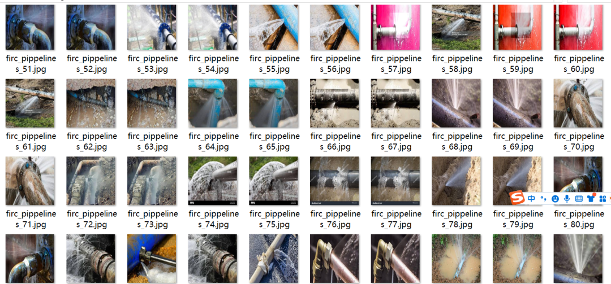
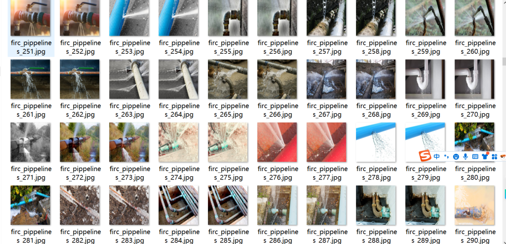
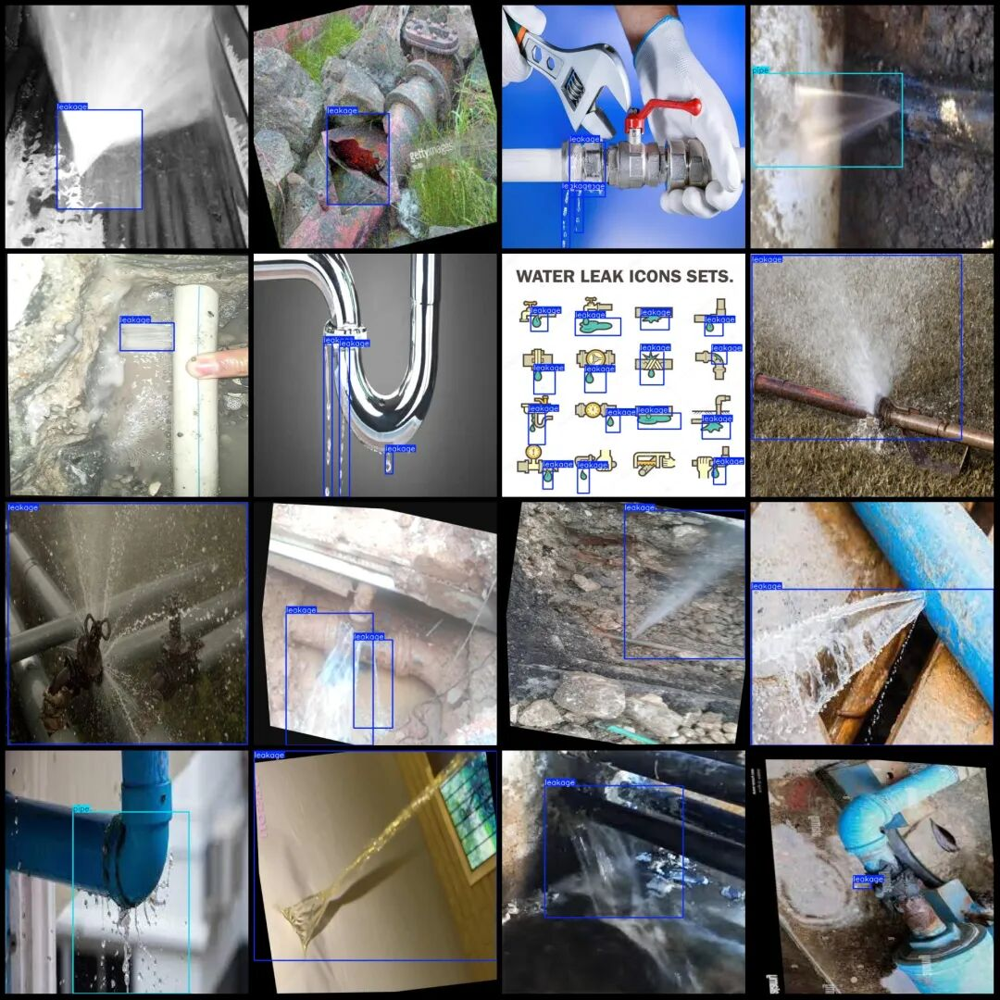
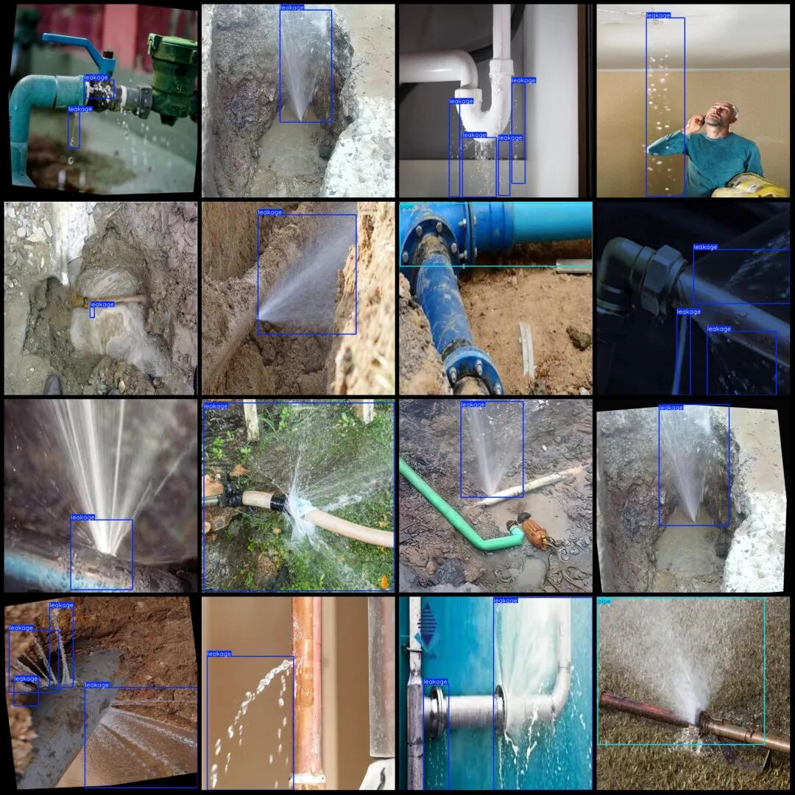

# Pipeline leakage detection dataset in VOC+YOLO format with 1131 images and 3 categories

Note: half of the dataset contains enhanced images, please view the image preview.

Dataset format: Pascal VOC format + YOLO format (txt file without split path, only containing jpg images and corresponding VOC format xml files and yolo format txt files)

Number of images (number of jpg files): 1131

Number of annotations (number of xml files): 1131

Number of annotations (number of txt files): 1131

Label category count: 3

Label category names (Note that the order of yolo format categories does not correspond to this, but is based on the classes.txt in the labels folder): ["cracks", "leakage", "pipe"]

Number of boxes labeled in each category:

Cracks (cracks) Frame count = 35

Leakage (leakage) frame count = 1438

Pipe (pipe) Frames = 247

Total frame count: 1720

Image resolution: 640x640

Using labelImg:

Annotation rules: Draw a rectangle around the category.

Important Notice: No

Special : This dataset does not guarantee the accuracy of the trained models or weight files.

Image Preview:

Annotation example:

## Payment

Here is a pay link on Stripe ( https://buy.stripe.com/3cs8yP7sY87d0vu9AB ). Please contact me lonlonago@foxmail.com after funding $89, and I will send you a complete data files , thank you!

